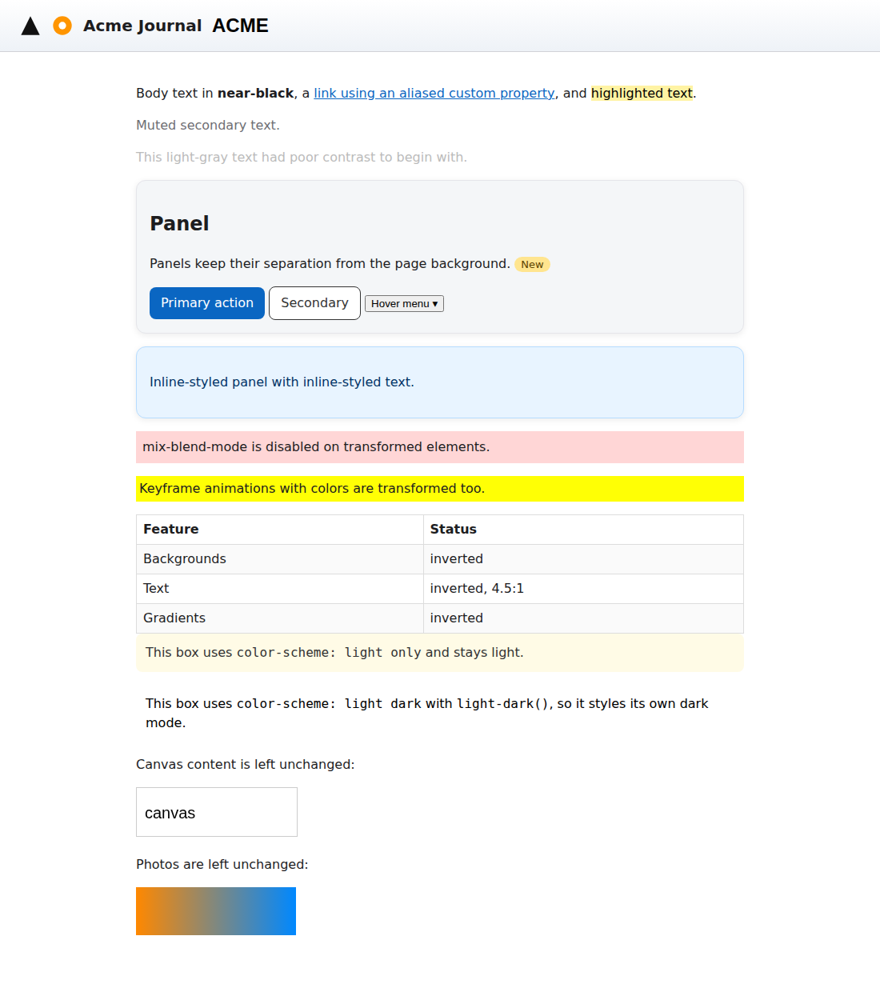
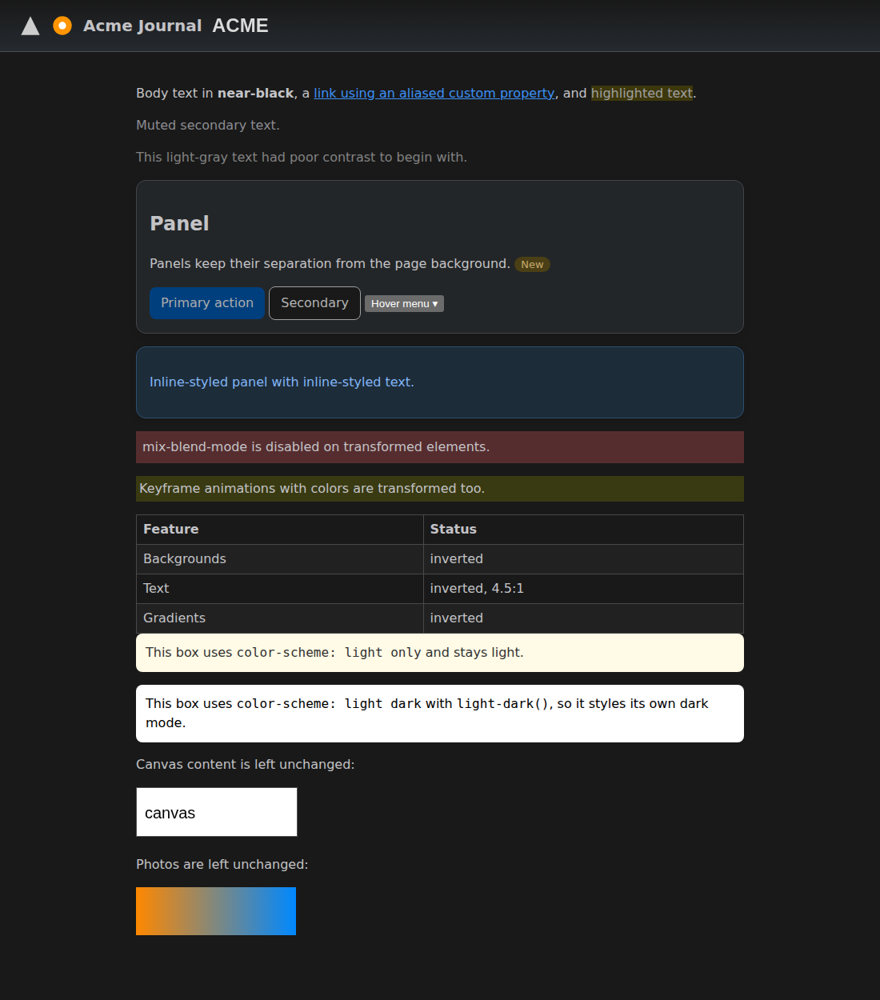

# adaptive-dark

A port of Safari's [Adaptive Dark Mode](https://webkit.org/blog/18541/introducing-adaptive-dark-mode/) to other browsers. When your system appearance is dark, it darkens light websites that don't support dark mode. It keeps hue, contrast and the site's own intent.

It comes in two forms:

- **`src/`**: a dependency-free JavaScript engine you can drop into any page (`AdaptiveDark.auto(document)`).
- **`extension/`**: a Manifest V3 extension that runs the engine on every site. It builds for **Firefox** (desktop 140+ and Android 142+) and for Chrome/Edge.

## Screenshots

The demo page before and after Adaptive Dark Mode. The dark view uses `?force`.

<p>
  
  
</p>

## What it does (following the WebKit article)

| Safari behavior | This port |
| --- | --- |
| Pages that declare dark support are left alone | `<meta name="color-scheme" content="… dark">` or a computed `color-scheme` containing `dark` on `html`/`body` → untouched |
| Dark pages aren't changed, light ones are darkened | A 7×7 grid of visible backgrounds is sampled. The page is transformed only if their mean OKLab lightness is ≥ 0.62 |
| Hue preserved, luminosity inverted | Each color is converted to OKLCH. Lightness is inverted into a range set by the color's role (background, text, border or shadow), hue is kept, and chroma is reduced only when needed to stay in sRGB gamut |
| Text aims for WCAG 4.5:1 | After the page is transformed, each text element is checked against its real composited background. If it falls short, its lightness is adjusted to reach 4.5:1 (3:1 for large text) |
| Light gradients are transformed | Colors inside `linear-`/`radial-`/`conic-gradient()` are rewritten |
| Decorative vs. semantic colors | Neutral surfaces are inverted. Saturated surfaces such as brand buttons, badges and highlights keep their hue and are only darkened moderately. Pale tints become dark tints, not gray |
| Buttons, hover menus keep contrast | Selectors are copied rather than resolved, so `:hover`/`:focus` rules and media queries still apply, with their colors transformed |
| SVG colors transformed when needed | An inline SVG is recolored only if none of its fills or strokes reaches 3:1 against what's behind it (for example a black icon). Colorful logos are left alone |
| B&W bitmap logos inverted via histogram | `` pixels are sampled (48 px). If nearly all opaque pixels are neutral black or white (dark ink on transparent, or dark ink on white), the image is inverted |
| Most images unchanged, `<canvas>` unchanged | Photos, video, canvas and iframes are not touched |
| `mix-blend-mode` may be disabled | Rules that set a blend mode get `mix-blend-mode: normal` |
| `color-scheme: light only` opts out | Supported on the page (meta or `:root`) and on individual elements. Those elements keep their original light colors |
| `color-scheme: light dark` on an element = custom dark section | That element and its descendants are left to the site's own `light-dark()` / dark styles |

### How the CSS is transformed

The engine never edits the page's own stylesheets or inline styles. Instead it creates one **adopted stylesheet** that mirrors every rule containing a color. The mirrored rules keep the original selector, `@media`/`@supports`/`@layer`/`@container` wrappers and `!important` flag, and come later in the cascade, so the original cascade order still decides which rule wins. In addition:

- **Custom properties** holding colors (including aliases like `--a: var(--b)`) get one mirror per role, such as `--adm-bg-brand` and `--adm-fg-brand`. `color: var(--brand)` is rewritten to `var(--adm-fg-brand, var(--brand))`. One variable can therefore be inverted correctly as both a background and a text color, and `getPropertyValue('--brand')` still returns the authored value.
- **Inline styles** are mirrored as `[data-adm-id="n"]{… !important}` rules.
- **`@keyframes`** that animate colors are re-emitted.
- **Cross-origin stylesheets**, whose `cssRules` can't be read, go through an optional `fetchText(url)` hook. The extension implements it in its background worker using its host permissions. Cross-origin logos use `fetchImage(url)` the same way.
- **Dynamic pages** are followed with a `MutationObserver`. A poll of stylesheet rule counts catches CSS-in-JS libraries that add rules with `insertRule`.

## Using the engine directly

```html
<script src="src/color.js"></script>
<script src="src/engine.js"></script>
<script>
  // Follow the OS appearance, like Safari:
  AdaptiveDark.auto(document);

  // Or drive it yourself:
  const adm = AdaptiveDark.create(document, {
    fetchText: async (url) => null,   // supply cross-origin CSS text
    fetchImage: async (url) => null,  // supply a data: URL for cross-origin images
  });
  adm.analyze();             // {decision: 'transform'|'supports-dark'|'opt-out'|'already-dark', lightness}
  adm.enable();              // transforms only if analyze() says 'transform'
  adm.enable({ force: true });
  adm.disable();             // removes everything it added
</script>
```

`src/color.js` also works on its own (CommonJS or global `AdaptiveDarkColor`). It provides color parsing, OKLab/OKLCH conversion, WCAG contrast, `transformColor(color, role)` and `rewriteValue(cssValue, role, ctx)`.

## Building the extensions

```sh
npm ci
npm run build             # dist/firefox and dist/chrome
npm run package:firefox   # web-ext-artifacts/adaptive-dark-firefox-<version>.zip (unsigned)
npm run package:chrome    # web-ext-artifacts/adaptive-dark-chrome-<version>.zip
```

`extension/` holds the shared sources and a base manifest. `scripts/build-extension.js` copies the engine into each target and writes that browser's manifest:

- **Firefox**: background `scripts`, a gecko id (`adaptive-dark@sevki.io`) and `data_collection_permissions: none`, which addons.mozilla.org requires.
- **Chrome**: a background service worker.

The build fails if `extension/manifest.json` and `package.json` have different versions.

### Installing

- **Firefox**: open `about:debugging#/runtime/this-firefox`, choose *Load Temporary Add-on* and select `dist/firefox/manifest.json`. Alternatively, run `npx web-ext run --source-dir dist/firefox`. A permanent install needs the signed `.xpi` from a release (see below).
- **Chrome / Edge**: open `chrome://extensions`, turn on Developer mode, choose *Load unpacked* and select `dist/chrome`.

The extension only runs while your browser or OS appearance is dark. Its popup shows why a page was or wasn't darkened. It has a per-site *Automatic / Always / Never* setting and a global switch. Firefox lets users withhold or revoke an MV3 extension's website access, so the popup offers an *Allow on all websites* button when access is missing.

### Firefox specifics

Firefox content scripts run in a sandbox that sees the page through Xray wrappers. The engine copes with three differences:

- From that sandbox, assigning to `document.adoptedStyleSheets` doesn't work (and in Firefox 140 it can't even be iterated). The engine detects this and writes its CSS to a `<style>` element that it keeps last in the document.
- Window methods are always called on the window object, never as detached functions.
- Reading the pixels of a page's `` taints the content script's canvas. Logos are therefore decoded again from their `data:` URL or from bytes fetched by the background script.

## Demo and tests

```sh
python3 -m http.server     # then open http://localhost:8000/demo/
                           # (?force to see it in light appearance too)
npm test                   # everything available locally
npm run test:unit          # color math (Node only)
npm run test:engine        # engine in Chromium; PW_BROWSER=firefox for Playwright's Firefox
FIREFOX_BIN=/path/to/firefox npm run test:firefox
                           # builds dist/firefox, installs it into real Firefox over
                           # WebDriver BiDi (puppeteer-core, no geckodriver) and
                           # checks pages served from a local server, including a
                           # cross-origin stylesheet fetched by the background script
```

## CI and releases

`.github/workflows/ci.yml` runs on every push to `main` and on every pull request:

| Job | What it checks |
| --- | --- |
| Lint | `node --check` on all JS; `web-ext lint` on the Firefox build with warnings treated as errors |
| Unit tests | Color math |
| Engine (chromium, firefox) | Engine end-to-end in both browsers via Playwright |
| Firefox extension (140.0esr, latest-esr, latest) | The built add-on installed into real Firefox: the minimum supported version, current ESR and release |
| Package | Builds the Firefox and Chrome zips and uploads them as a workflow artifact |

`.github/workflows/release.yml` runs when a `v*` tag is pushed (for example `v0.2.0`; it must match `package.json` and `extension/manifest.json`). It:

1. runs all the tests;
2. signs the Firefox add-on with addons.mozilla.org via `web-ext sign`;
3. creates a GitHub release with the signed `.xpi` and the Chrome zip.

Setup:

- Add repository secrets **`AMO_JWT_ISSUER`** and **`AMO_JWT_SECRET`**, using the API key from <https://addons.mozilla.org/developers/addon/api/key/>.
- The signing channel defaults to `unlisted`: AMO signs the add-on for self-distribution, and the `.xpi` can be installed permanently from the release. To submit to the public AMO listing, set the repository variable **`AMO_CHANNEL=listed`** or choose `listed` when running the workflow manually. That path uses `amo-metadata.json`. AMO asks for a license for listed add-ons, so add one there (and a `LICENSE` file) first.

Dependabot keeps the npm dev dependencies and GitHub Actions up to date.

## For site authors

The article's advice applies here too:

- To opt out: `<meta name="color-scheme" content="light only">` or `:root { color-scheme: light only }`. You can also apply it to individual elements.
- Better still, support dark mode yourself: `color-scheme: light dark`, `prefers-color-scheme`, `light-dark()`. Declare it in the HTML head or in CSS, not later from JavaScript.
- Use SVG for logos and icons, CSS colors and gradients instead of tiled images, and transparent backgrounds on content images.

## Differences from Safari

Safari does this inside the rendering engine. A script or extension can't do everything the same way:

- **Privacy.** In Safari, pages can't tell the mode is active. Here, `getComputedStyle` returns the transformed colors, and the adopted stylesheet and `data-adm-*` attributes can be seen by the page. Authored custom property values do stay unchanged, and canvas still draws images in their original form.
- **Shadow DOM.** Styles inside shadow roots aren't transformed yet.
- **Timing.** Pages are analyzed at `DOMContentLoaded`, so a light page can flash briefly before it's darkened.
- Safari decides "semantic vs. decorative" with heuristics that aren't public. The rules here are this port's own approximation.
